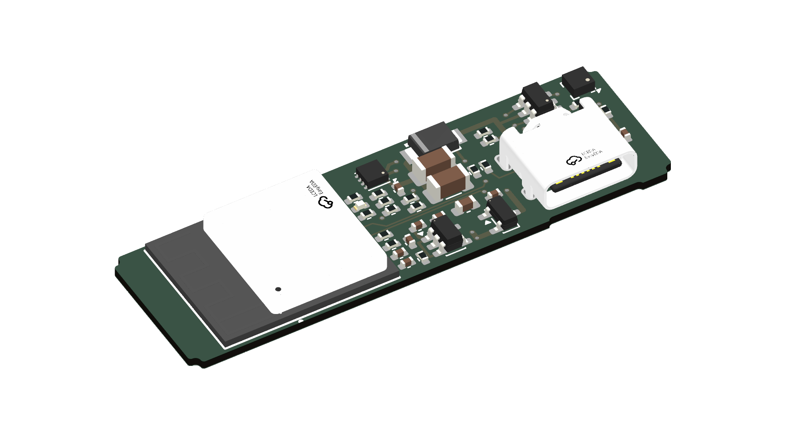
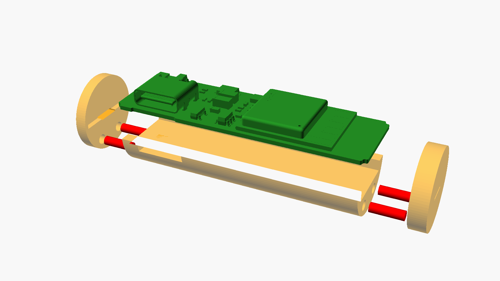
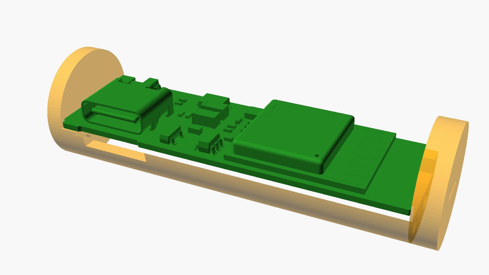

# Looping Louie Wi-Fi upgrade

Retrofit electronics for **Looping Louie** (old and new edition) and **Loopin' Chewie**. The board goes into the
**battery compartment without soldering** and makes the game controllable from a **web UI on your phone**, with
game modes, custom modes, game master and player roles. The original lever keeps working as start/stop.



*Main board (46 × 14.1 mm, AA format, 4 layers): ESP32-C6 module on the left, motor driver and power path in the
middle, USB-C on the right. Rendered from the current KiCad layout (`just images`).*

| Exploded | Assembled |
|---|---|
|  |  |

*The real board (KiCad 3D export) in the 3D-printed AA sleeve: shell, two end caps, filament dowels (red). Nickel
strips from the bottom pads make the battery contacts. The board registers in the slots of the end caps; the
envelope check `just hull` confirms it stays inside the AA diameter.*

## Status

> 2026-11-08 · restart on branch `v2`, nothing ordered yet.

| Part | State |
|---|---|
| Concept | done ([hardware](docs/hardware-concept.md), [software](docs/software-concept.md), [web UI](docs/web-ui-concept.md)) |
| Main board | schematic done; placement revised on 2026-11-07 and not routed again yet (the last accepted routing, in Git, had 12 connections open and 2 DRC errors) ([main-board-c6.md](docs/main-board-c6.md)) |
| Charger board | schematic and layout done, ERC/DRC clean ([charger-board.md](docs/charger-board.md)) |
| 3D-printed parts | AA sleeve, C-cell adapter and charger holder modelled; checked against the current layout (`just hull`) |
| Firmware | Rust, step 0 written (bring-up and test probes), not built yet ([firmware/louie-fw](firmware/louie-fw/README.md)) |
| Web UI | clickable prototype ([web/poc](web/poc/README.md)) |

The old MicroPython/ESP8266 version is in the tag `v1-legacy`.

## Components

| Assembly | Description |
|---|---|
| **Main board** | AA cell format, 4 layers, components on one side: ESP32-C6-MINI-1 (Wi-Fi, BLE), DRV8213 H-bridge with current sensing, USB-C for flashing and 5 V operation, lever detection; solder pads on the bottom for player inputs, LEDs, I²C |
| **Charger board** | also AA format: USB-C (charging), charge controller, LiPo connection. Sits upright in the second compartment (replaces the bridge there) or is glued into the base |
| **Bridge** | copper AA dummy for the second compartment when the charger board sits in the base |
| **AA sleeve / C-cell adapter** | 3D-printed shell with end caps that holds the main board in the AA compartment; an extra sleeve makes it fit the C-cell compartment of the old Louie ([hardware/mechanics](hardware/mechanics/README.md)) |
| **Firmware** | Rust (std on ESP-IDF); game logic as a hardware-independent crate that runs on the ESP, in PC tests and as WebAssembly in the browser (mode preview) |
| **Web UI** | served offline by the ESP; concept and clickable prototype in `web/poc` |

## Documentation

- Hardware: [hardware concept](docs/hardware-concept.md), [main board](docs/main-board-c6.md),
  [charger board](docs/charger-board.md) (with wiring diagram), [3D-printed parts](hardware/mechanics/README.md)
- Software: [firmware architecture](docs/firmware-architecture.md), [software concept](docs/software-concept.md),
  [web UI concept](docs/web-ui-concept.md), [mode builder](docs/mode-builder.md), [device pairing](docs/device-pairing.md)
- Test setup before the board exists: [test hardware](docs/test-hardware.md)
- Development workflow (tools, generators, router, routing score): [development](docs/development.md),
  [routing score](docs/routing-score.md)
- Open items and decisions: [open items](docs/open-items.md), [decision history](docs/decision-history.md)
- Costs: [cost estimate](docs/cost-estimate.md)
- Ideas and studies: [ideas](docs/ideas.md), [optional hardware](docs/idea-optional-hardware.md),
  [wireless buttons](docs/idea-wireless-buttons.md), [power bank](docs/idea-power-bank.md),
  [Zigbee](docs/idea-zigbee-operation.md), [wireless controllers](docs/analysis-wireless-controllers.md)

## Directories

```
docs/                 concepts, decisions, development guide, images (docs/images/)
hardware/
  bom/parts.csv       BOM with manufacturer parts, LCSC numbers, alternatives
  lib/                project library (symbols, footprints, 3D models) – created with just parts
  main-board/         KiCad project of the main board (4 layers)
  charger-board/      KiCad project of the charger board (2 layers)
  mechanics/          3D-printed parts (OpenSCAD): main board sleeve, charger board holder
  scripts/            generators (schematic, layout, placement), router with keep-best gate,
                      routing score, envelope check, part fetching, tool check
  routing-score.toml  weights of the routing score
web/
  poc/                clickable web UI prototype (one HTML file, offline)
  prototype/          first, outdated UI draft
firmware/louie-fw/    Rust firmware (ESP-IDF), step 0: bring-up and test probes
tools/                downloaded tools (Freerouting, pre-router), created by setup.sh, not in Git
justfile              all development commands (just --list)
setup.sh              installs all tools
```

## Quick start

```bash
./setup.sh     # install all tools (once, Ubuntu/Debian)
just check     # check the tools
just --list    # all commands
```

Common commands:

```bash
just images    # board renders, copper layers, schematic, sleeve assembly → docs/images/
just model     # 3D model of the board (STEP, GLB, STL) → build/main-board/3d/
just hull      # check the board against the AA sleeve
just stl       # 3D-print files and previews → build/mechanics/
just fab       # Gerber, drill, CPL and BOM for fabrication → build/main-board/fab/
```

Setup and workflow in detail: [docs/development.md](docs/development.md)

## License

Using, building and adapting the project is free for **non-commercial purposes**; making money with the project
requires prior permission. Software: [PolyForm Noncommercial 1.0.0](LICENSES/PolyForm-Noncommercial-1.0.0.md),
hardware and docs: [CC BY-NC-SA 4.0](LICENSES/CC-BY-NC-SA-4.0.txt). Details and exceptions: [LICENSE](LICENSE).
