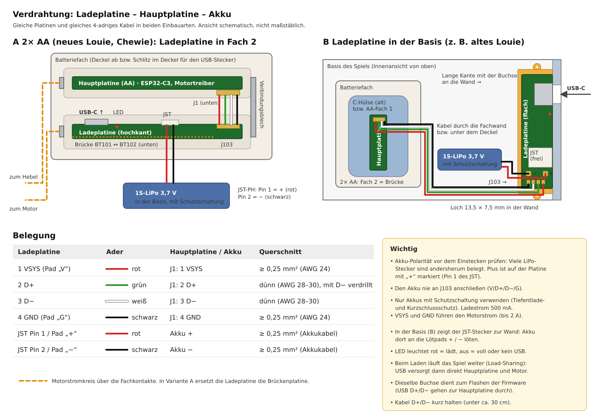
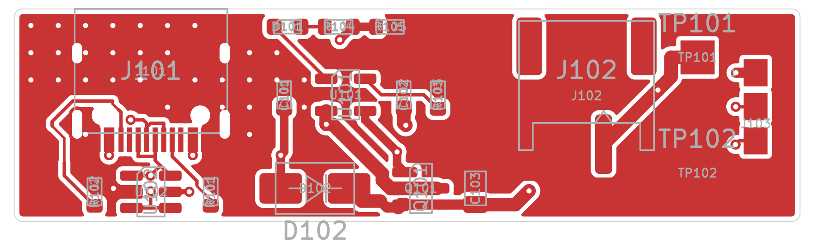
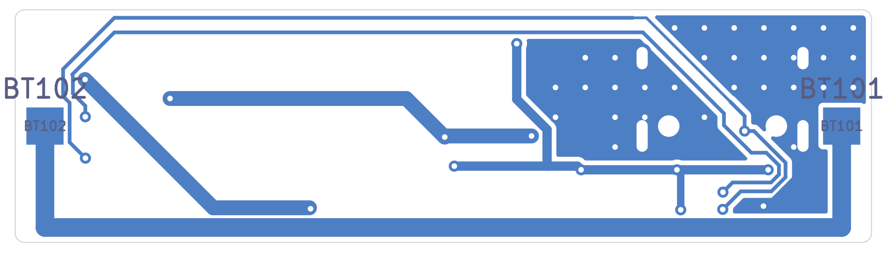
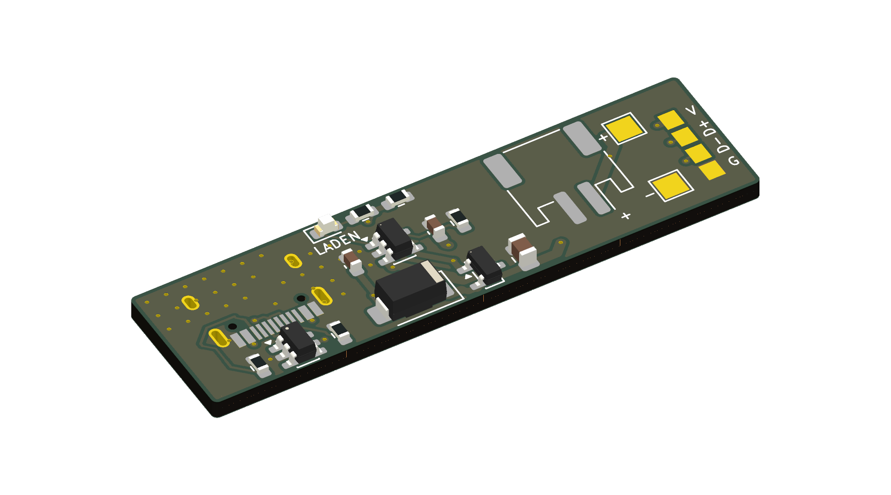
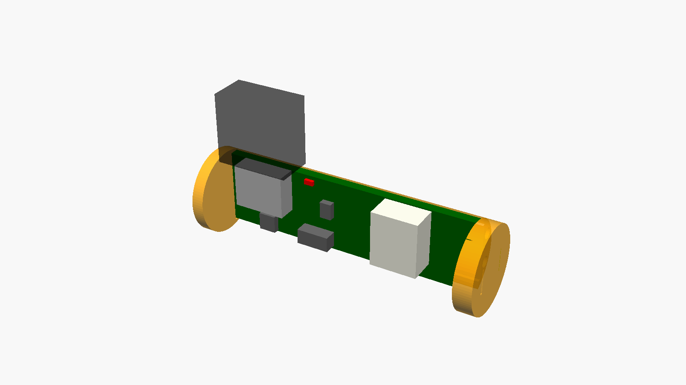
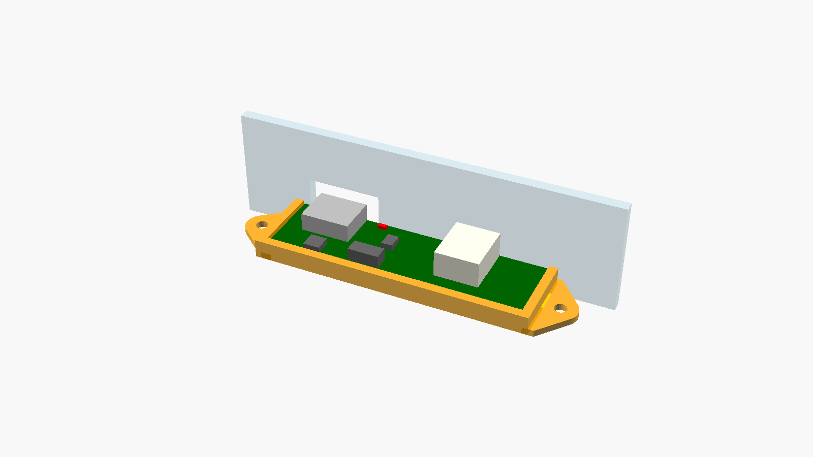

# Ladeplatine

Stand: 2026-11-01 · Status: Schaltplan und Layout erzeugt (ERC/DRC ohne Fehler), noch nicht bestellt

Die Ladeplatine sitzt zwischen USB-C, Akku und Hauptplatine: Sie lädt den 1S-LiPo, versorgt
beim Laden direkt das Spiel und reicht USB D+/D− zum ESP32-C3 durch (**eine Buchse zum Laden und
Flashen**). Sie hat das Format der Hauptplatine, damit sie **in ein AA-Fach passt**. Alternativ wird
sie **in die Basis des Spiels geklebt**.



## 1. Einbauarten

| | A: im AA-Fach (Standard bei 2× AA) | B: in der Basis |
|---|---|---|
| Wo | Fach 2, **statt der Brückenplatine** | an der Innenwand der Basis, Loch in der Wand |
| Lage | **hochkant** im 3D-gedruckten AA-Einsatz | flach im Basis-Halter |
| USB-C | zeigt **nach oben** aus dem Fach (Stecker quer zur Zellachse) | zeigt durch die Wand nach außen |
| Brücke im Fach | übernimmt die Ladeplatine (BT101 ↔ BT102) | Brückenplatine B nötig (nur 2× AA) |
| Akku | JST-PH oder Lötpads | **nur Lötpads** (der JST zeigt zur Wand) |
| Für | neues Louie, Chewie | altes Louie (1× C); auch 2× AA, wenn das Fach zu bleiben soll |

Der Akku liegt in beiden Fällen in der Basis. Beim Einbau A muss man zum Laden den Fachdeckel
abnehmen oder einen Schlitz für den Stecker (ca. 13 × 7 mm) in den Deckel schneiden.

### Warum hochkant und eine liegende Buchse

- An den Enden der AA-Form sitzen die Fachkontakte, dort kann keine Buchse hin.
- Eine **liegende** USB-C-Buchse an der Längskante zeigt bei hochkant stehender Platine nach oben, also
  quer zur Zellachse („90°“). Liegt dieselbe Platine flach in der Basis, zeigt die Buchse zur Seite
  durch die Wand. **Eine Platine passt damit für beide Einbauarten.**
- Stehende (vertikale) USB-C-Buchsen sind 6–11 mm hoch und passen flach liegend nicht in die AA-Form;
  in der Basis würden sie nach oben zeigen.
- Geometrie im Fach (Ø 14,5 mm): Platine 12,5 mm breit, Rückseite 3,2 mm hinter der Zellachse. Die
  Ecken liegen auf r = 7,0 mm, die Mitte der Buchse (3,26 mm hoch) liegt fast genau auf der Achse. Der
  Stecker kommt damit mittig von oben. Auf der Bestückungsseite ist bis zu 8 mm Platz.
- 1,6 mm Platinendicke: Die Buchse wird beim Stecken belastet, die THT-Laschen halten in 1,6 mm am
  besten. Die AA-Form lässt das zu, weil die Platine nicht flach liegt.

## 2. Schaltung

Schaltplan: [`hardware/charger-board/louie-charger.kicad_sch`](../hardware/charger-board/louie-charger.kicad_sch)
(erzeugt mit `just charger-schematic`), Bild: [bilder/lade-schaltplan.png](bilder/lade-schaltplan.png).
Bauteile: [`hardware/bom/teile.csv`](../hardware/bom/teile.csv), Zeilen `lade`.

| Block | Bauteile | Auslegung |
|---|---|---|
| USB-C | J101 HRO TYPE-C-31-M-12, R101/R102 5,1 k | 16-polige Buchse, CC-Widerstände = Senke: jedes USB-C-Netzteil schaltet 5 V ein (auch C-auf-C-Kabel). |
| ESD | U102 USBLC6-2SC6 | D+, D− und VBUS gegen Entladungen beim Stecken. |
| Laderegler | U101 MCP73831-2 (4,20 V), R103 2 k | Ladestrom 1000 V / R103 = **500 mA** (2 h für 1000 mAh). Für kleine Akkus 3,3 k = 300 mA. Thermische Regelung im IC, wird bei Hitze selbst langsamer. |
| Ladeanzeige | D101 rot, R104 1 k | STAT zieht beim Laden auf GND: LED an. Voll oder kein USB: aus. Sitzt an der Steckkante, von oben sichtbar. |
| Load-Sharing | D102 SS34, Q101 AO3401A, R105 100 k | Microchip AN1149. Mit USB: VBUS speist über D102 das System (VSYS ≈ 4,6 V), Q101 sperrt, der Laderegler sieht nur den Akku und beendet die Ladung korrekt. Ohne USB: R105 zieht das Gate auf GND, Q101 leitet, Akku → VSYS. |
| Puffer | C101/C102 4,7 µF, C103 10 µF | Die großen Motor-Puffer (3 × 47 µF) sitzen auf der Hauptplatine. |
| Anschlüsse | J102 JST-PH, TP101/TP102 Lötpads, J103 Lötpads | J103 hat dieselbe Belegung wie J1 der Hauptplatine: 1 VSYS, 2 D+, 3 D−, 4 GND. |
| Brücke | BT101, BT102, 1-mm-Bahn unten | Verbindet die beiden Fachkontakte (Motorstromkreis), elektrisch getrennt vom Rest. |

Hinweise zur Schaltung:

- **Spielen beim Laden:** Mit USB läuft auch der Motor aus VBUS. Zieht der Motor mehr, als das Netzteil
  liefert, sinkt VSYS; unter Akkuspannung − 0,7 V hilft der Akku über die Body-Diode von Q101 mit.
  Die Firmware misst VSYS (Teiler auf der Hauptplatine) und regelt die Motorspannung darüber, also
  auch bei 4,6 V aus USB richtig. D102 (3 A) ist für die 2-A-Strombegrenzung des Motortreibers ausgelegt.
- **Keine Ladeerkennung zur Hauptplatine:** Dafür ist kein GPIO frei. Erkennbar ist USB indirekt an
  VSYS > 4,3 V.
- **Akkuschutz:** Nur Akkus mit eingebauter Schutzschaltung verwenden (wie im Hardware-Konzept).

## 3. Platine

Erzeugt mit `just charger-pcb` (Umriss, Platzierung, Vorrouting, danach Freerouting):
[`hardware/scripts/gen_charger_pcb.py`](../hardware/scripts/gen_charger_pcb.py).

- **46 × 12,5 mm, 1,6 mm dick, 2 Lagen, nur oben bestückt** (15 Bauteile, dazu 5 reine Lötpads)
- Passive in 0603 (Handlöten möglich, Platz ist genug)
- Von links: USB-C mit ESD und CC-Widerständen | Laderegler, LED, Load-Sharing | JST und Akku-Pads | Kabel-Pads
- Unten: Brücke (1 mm, ca. 20 mΩ) am Rand entlang, sonst Massefläche; GND wird hier mitgeroutet, weil
  Brücke und Leistungsbahnen die Fläche sonst in Inseln zerteilen
- VBUS ist vorgeroutet (Via hinter jedem VBUS-Pad, unten gesammelt); Freerouting schafft die feinen Pads nicht
- Netzklassen: VSYS, BAT, Brücke 0,8 mm; VBUS 0,5 mm; Rest 0,2 mm

| Oben | Unten |
|---|---|
|  |  |



DRC: keine Fehler, keine Warnungen, keine offenen Verbindungen. Beim USB-Footprint ist der Bestückungsdruck
entfernt (lief über die Platinenkante); die Meldung „weicht von der Bibliothek ab“ ist deshalb im Projekt
abgeschaltet.

## 4. Mechanik

Modell: [`hardware/mechanik/ladeplatine.scad`](../hardware/mechanik/ladeplatine.scad), Export mit `just stl`
(`lade_*.stl` in `build/mechanik/`).

### A: AA-Einsatz (hochkant)



Gleiches Prinzip wie der Einsatz der Hauptplatine: **Schale** (Kreissegment hinter der Platine,
aufrecht gedruckt) + **zwei Endkappen** mit senkrechtem Platinenschlitz, gesteckt mit Filament-Dübeln.
Die Nickelbänder auf BT101/BT102 laufen durch die Kappen zu den Fachkontakten. Die Bestückungsseite
ist offen, die Fachwand schließt sie ein.

### B: Basis-Halter



Flache Wanne mit zwei Laschen (Ø 2,2 mm für M2 oder Blechschraube, oder einfach kleben). Die Buchse
sitzt an der **langen Kante** der Platine (Stecker liegt in der Platinenebene, quer zur Längsachse).
Deshalb liegt die Platine **mit der langen Seite an der Wand**, nicht mit der Stirnseite. Die lange
Kante mit der Buchse schließt bündig mit der offenen Längsseite des Halters ab.

- Loch in der Wand: **13,5 × 7,5 mm** (Umspritzung des USB-C-Steckers ist bis ca. 12,4 × 6,5 mm)
- Lochmitte **4,4 mm** über der Fläche, auf der der Halter steht
- seitlich **9,8 mm** vom linken Halterende (von innen auf die Wand gesehen)
- Bei Wänden über ca. 2 mm den Halter so weit in das Loch schieben bzw. die Wand innen dünner
  feilen, dass der Stecker ganz in die Buchse geht (Steckweg ca. 6,5 mm).

## 5. Verdrahtung

Siehe Bild oben ([SVG](bilder/verdrahtung.svg)).

| Ladeplatine | Ader | Hauptplatine / Akku | Querschnitt |
|---|---|---|---|
| J103-1 VSYS („V“) | rot | J1-1 VSYS | ≥ 0,25 mm² (Motorstrom bis 2 A) |
| J103-2 D+ | grün | J1-2 D+ | dünn, mit D− verdrillt |
| J103-3 D− | weiß | J1-3 D− | dünn |
| J103-4 GND („G“) | schwarz | J1-4 GND | ≥ 0,25 mm² |
| J102 Pin 1 / Pad „+“ | rot | Akku + | Akkukabel |
| J102 Pin 2 / Pad „−“ | schwarz | Akku − | Akkukabel |

**Akku-Polarität vor dem Einstecken prüfen.** LiPo-Akkus mit JST-PH-Stecker gibt es mit beiden
Belegungen. Auf der Platine ist Pin 1 mit „+“ markiert; notfalls die Kontakte im Stecker umsetzen
oder an die Lötpads löten.

## 6. Offene Punkte

| # | Punkt | Vorschlag |
|---|---|---|
| L1 | Passt der Stecker beim neuen Louie von oben ins Fach (Deckel, Fachränder)? | am Spiel nachmessen; sonst Variante B |
| L2 | Erwärmung des MCP73831 bei 500 mA im geschlossenen Fach | beim Prototyp messen; sonst R103 = 3,3 k (300 mA) |
| L3 | Polarität der verwendeten Akkus (JST-PH) | beim Kauf prüfen, ggf. Akku mit passender Belegung wählen |
| L4 | Kontaktdruck der Nickelbänder an den Fachkontakten (Brücke führt Motorstrom) | wie Hauptplatine (offene Punkte F3) |
| L5 | Wandstärke der Basis und Lage des Lochs | am Spiel messen, Halter ggf. anpassen (`boden`, Parameter in der SCAD-Datei) |
| L6 | USB-Datenübertragung über das 4-adrige Kabel | wie A8 in den offenen Punkten; kurz halten |

## 7. Befehle

```
just charger-schematic      Schaltplan erzeugen (überschreibt!) + ERC
just charger-pcb            Platine neu anlegen und routen (überschreibt Layout!)
just route charger-board    nur neu routen
just drc charger-board      DRC inkl. Schaltplan-Abgleich
just images charger-board   Bilder nach docs/bilder/lade-*.png
just fab charger-board      Fertigungsdaten
just stl                    Druckteile, inkl. lade_*.stl
```
