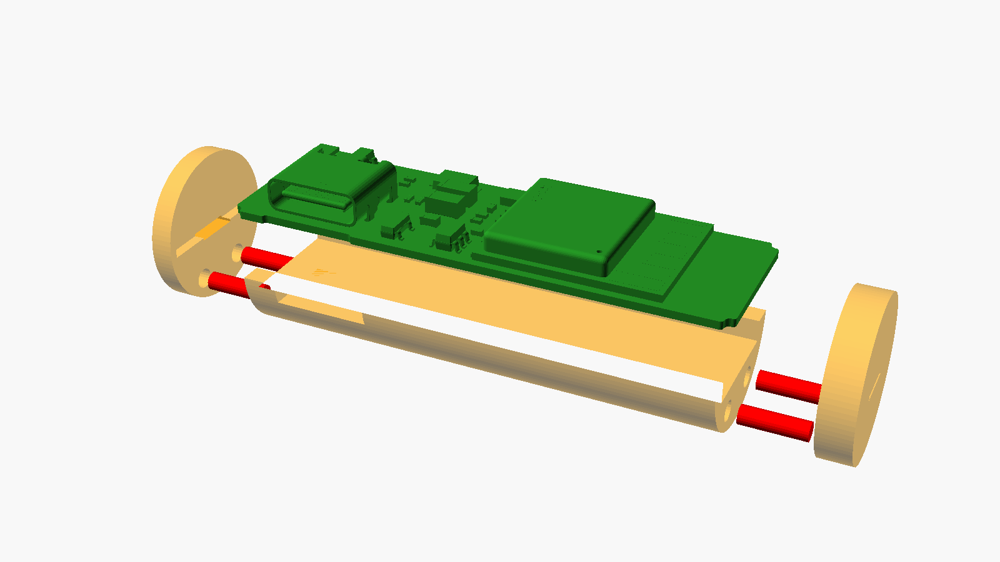

# Mechanics: sleeve for the main board

> The holder for the **charger board** (AA insert on edge or base holder) is in
> [`charger-holder.scad`](charger-holder.scad), described in [docs/charger-board.md](../../docs/charger-board.md) section 4.

A 3D-printed insert that gives the main board the size of an AA cell (new Louie, Chewie),
plus an adapter sleeve for the old Louie with a C cell.

- Model: [`sleeve.scad`](sleeve.scad) (OpenSCAD, all dimensions as parameters at the top of the file)
- Export: `just stl` → STL files and preview images in `build/mechanics/`
- Concept and background: [`docs/hardware-concept.md`](../../docs/hardware-concept.md), section 6

## Parts

| Part | STL | Qty | Print orientation | Material (PLA, approx.) |
|---|---|---|---|---|
| AA shell | `aa_shell.stl` | 1 | standing upright | 2.5 cm³ · 3 g |
| Cap plus (with nub) | `cap_plus.stl` | 1 | inner face on the bed | 0.3 cm³ · 0.4 g |
| Cap minus | `cap_minus.stl` | 1 | inner face on the bed | 0.5 cm³ · 0.6 g |
| C sleeve (old model only) | `c_sleeve.stl` | 1 | standing upright | 16 cm³ · 20 g |

The STL files are already in print orientation, so do not rotate them.

**Printing without supports:** the shell and the C sleeve have the same cross-section over
their whole length, so printing them upright has no overhangs. On the caps the printer only
has to bridge the board slot (1.2 mm). The cable window of the shell has a 2 mm bridge at the
top.

Recommendation: 0.4 mm nozzle, 0.12–0.16 mm layer height, 100 % infill (the parts are almost
solid anyway). Consider a brim for the slim shell (14.5 × 44 mm).

## What the holes and slots are for

| Opening | Where | Purpose |
|---|---|---|
| **Dowel holes Ø 1.95 mm** | 2 in each end face of the shell and in each cap | Joins shell and cap. A piece of **1.75 mm filament** goes in as a dowel. 4 dowels of approx. 6 mm. |
| **Board slot** | inner face of each cap, 13.9 × 1.2 mm, 0.8 mm deep | Takes the board end (12.5 mm tongue). Holds the board upwards, sideways and lengthwise. |
| **Strip slot** | cap, under the board slot, through | Guides the nickel strip (end contact) from the board bottom to the outside. |
| **Pocket** | shell, under the board over the whole length, 10.4 mm wide, 2.0 mm deep | Room for the bottom pads (J1, J2, J3, J5, J6, J7, TP1, TP2, JP1, BT1, BT2), solder and wires, plus the optional bottom parts U6, F1 and C17 (DNP by default, up to 1.45 mm high). The board rests only on the two edge ledges. |
| **Cable window** | shell, side +y under the USB-C socket J4 (over J1 and J5) | Exit for the cable to the charger board and the cell wires (J1/J5 are under J4 at the +y edge). |
| **Lengthwise slot** | C sleeve | Cable routing; it also lets the sleeve flex a little so it clamps the insert. |

There are no screws. The insert is held together by the dowels and, in the compartment,
also by the contact spring that presses the caps against the shell.

## Assembly

Needed: nickel strip 4 × 0.15 mm (approx. 2 × 10 mm), some 1.75 mm filament, 4-wire cable,
optionally a drop of superglue.

1. **Cut the dowels:** 4 pieces of filament, approx. 6 mm each, ends slightly chamfered. Push
   2 into the holes of the shell at each end. If they are too loose, secure them with a drop
   of glue. If they are too tight, ream the hole by hand with a 2 mm drill.
2. **Contact strips:** solder a nickel strip to each of the pads BT1 and BT2 on the bottom.
   It should stick straight out beyond the end of the board.
3. **Solder the cable** to J1 (bottom) and route it sideways out through the cable window.
4. **Insert the board:** components facing up, the strips lie in the pocket.
5. **Fit the caps:** first thread the strip through the strip slot of the cap. Then push the
   cap onto the dowels until the board end sits in the slot. The plus cap goes on the end
   that sits at the positive terminal in the compartment.
6. **Bend the strips:** lay each strip across the centre of the outside of the cap and cut it
   off about 1 mm past the edge. On the plus cap, lay the strip over the nub.
7. **Old model only:** slide the insert into the C sleeve with the cable window facing the
   lengthwise slot.

## Views

- `part = "assembly"`, `"assembly_c"`, `"exploded"`: views with a board dummy (component heights
  from data sheets, including the optional bottom parts U6/F1/C17).
- `board_stl = true`: the same views with the real board from the KiCad 3D export
  (`just model` → `build/main-board/3d/louie-main.stl`), placed exactly where the dummy is.
  OpenSCAD 2021.01 shows it in the preview (F5, or the command line without `--render`); a full
  CGAL render of the KiCad STL may fail.
- `part = "collision"`: shows what sticks out of the AA envelope (empty = no collision).
- `shell_alpha`: transparency of shell and caps in the views.

## Limitations and adjustments

- **Open top:** the board (14.1 mm wide, ends 12.5 mm in the cap slot, `pcb_tongue_w`) is almost
  as wide as an AA cell (14.5 mm). Above the ESP32 module there is no room for a wall at the
  edge, so the AA insert has no lid. In the compartment its wall encloses the insert. In the C
  sleeve it is closed all round.
- **Fit:** adjust `clearance` (0.2 mm) and `dowel_hole` to your printer. Best print just one
  cap and a short piece of shell first.
- **Positive terminal nub:** `plus_nub = false` if the compartment has no reverse-polarity
  ribs.
- **Cable window:** there is only one, on the +y side over J1/J5; `cable_side` selects the side.
  Whether the cable fits past the lid of the new model is still open (open items, F2).
- **Optional pads without a cable exit:** wires to the optional pads J2, J3, J6 and J7 have no
  exit of their own. They would have to run along the pocket to the cable window or leave past
  the open top. Open item.
- **No ledge under J4:** because of the cable window, the edge ledge that supports the board
  is missing under the USB-C socket J4 (open). The socket itself sits at the top of the +y edge
  and is freely accessible.
- **Backup case** (board A + B together in the C sleeve): not modelled.
- The component heights in the board dummy are approximations from the data sheets (C6 board
  with USB-C J4). They are only for the collision check in the views. The module dummy is set
  slightly too high (2.55 mm) and sticks out just barely at the edges in `part = "collision"`.
  Check with the real 3D export: `board_stl = true`, `just hull`, docs/main-board-c6.md
  section 6. Current result: the board fits (max. radius 7.06 mm < 7.25 mm; bottom parts
  within |y| ≤ 3.35 mm of the 10.4 mm pocket and above its floor).
