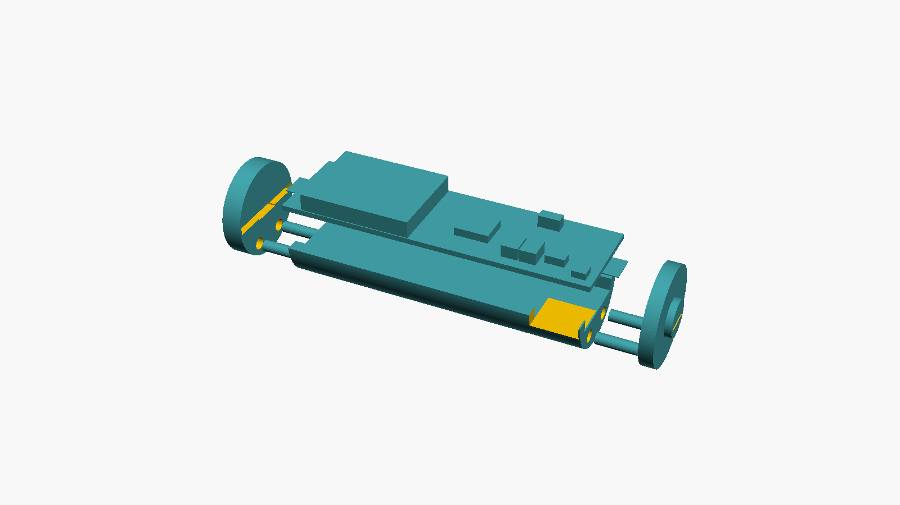

# Mechanik: Hülle für die Hauptplatine

Ein 3D-gedruckter Einsatz, der die Hauptplatine in AA-Größe bringt (neues Louie, Chewie),
dazu eine Adapterhülse für das alte Louie mit C-Zelle.

- Modell: [`huelle.scad`](huelle.scad) (OpenSCAD, alle Maße als Parameter oben in der Datei)
- Export: `just stl` → STL-Dateien und Vorschaubilder in `build/mechanik/`
- Konzept und Hintergründe: [`docs/hardware-konzept.md`](../../docs/hardware-konzept.md), Kapitel 6

## Teile

| Teil | STL | Anzahl | Druckausrichtung | Material (PLA, ca.) |
|---|---|---|---|---|
| AA-Schale | `aa_schale.stl` | 1 | aufrecht stehend | 2,5 cm³ · 3 g |
| Kappe plus (mit Nippel) | `kappe_plus.stl` | 1 | Innenseite auf dem Bett | 0,3 cm³ · 0,4 g |
| Kappe minus | `kappe_minus.stl` | 1 | Innenseite auf dem Bett | 0,5 cm³ · 0,6 g |
| C-Hülse (nur altes Modell) | `c_huelse.stl` | 1 | aufrecht stehend | 16 cm³ · 20 g |

Die STL-Dateien liegen schon in Druckausrichtung, also nicht drehen.

**Druck ohne Stützmaterial:** Schale und C-Hülse haben über die ganze Länge denselben
Querschnitt, deshalb gibt es beim aufrechten Druck keine Überhänge. Bei den Kappen muss der
Drucker nur über den Platinenschlitz brücken (1,2 mm). Das Kabelfenster der Schale hat oben
eine 2-mm-Brücke.

Empfehlung: 0,4-mm-Düse, 0,12–0,16 mm Schichthöhe, 100 % Füllung (die Teile sind ohnehin
fast massiv). Die schlanke Schale (14,5 × 44 mm) eventuell mit Brim drucken.

## Wozu die Löcher und Schlitze dienen

| Öffnung | Wo | Zweck |
|---|---|---|
| **Dübellöcher Ø 1,95 mm** | je 2 in jeder Stirnseite der Schale und in jeder Kappe | Verbindung Schale ↔ Kappe. Dort hinein steckt ein Stück **1,75-mm-Filament** als Dübel. 4 Dübel à ca. 6 mm. |
| **Platinenschlitz** | Innenseite jeder Kappe, 13,9 × 1,2 mm, 0,8 mm tief | Nimmt das Platinenende auf. Hält die Platine nach oben, zur Seite und in der Länge. |
| **Bandschlitz** | Kappe, unter dem Platinenschlitz, durchgehend | Führt das Nickelband (Endkontakt) von der Platinenunterseite nach außen. |
| **Tasche** | Schale, unter der Platine über die ganze Länge | Platz für die Lötpads unten (J1, J2, J3, BT1, BT2), Lötzinn und Kabel. Die Platine liegt nur auf den beiden Randstegen auf. |
| **Kabelfenster** | Schale, seitlich auf Höhe von J1 | Hier geht das 4-adrige Kabel zur Ladeplatine hinaus. |
| **Längsschlitz** | C-Hülse | Kabelführung; außerdem federt die Hülse dadurch etwas und klemmt den Einsatz. |

Es gibt keine Schrauben. Zusammengehalten wird der Einsatz durch die Dübel und im Fach
zusätzlich durch die Kontaktfeder, die die Kappen gegen die Schale drückt.

## Zusammenbau

Benötigt: Nickelband 4 × 0,15 mm (ca. 2 × 10 mm), etwas 1,75-mm-Filament, 4-adriges Kabel,
optional ein Tropfen Sekundenkleber.

1. **Dübel schneiden:** 4 Stücke Filament à ca. 6 mm, Enden leicht anfasen. Je 2 in die
   Löcher der Schale stecken. Sind sie zu locker, mit einem Tropfen Kleber sichern. Sind sie
   zu stramm, das Loch mit einem 2-mm-Bohrer von Hand nacharbeiten.
2. **Kontaktbänder:** Je ein Nickelband auf die Pads BT1 und BT2 an der Unterseite löten. Es
   soll gerade nach außen über das Platinenende hinausstehen.
3. **Kabel** an J1 (Unterseite) löten und seitlich durch das Kabelfenster führen.
4. **Platine einlegen:** Die Bestückung zeigt nach oben, die Bänder liegen in der Tasche.
5. **Kappen aufstecken:** Zuerst das Band durch den Bandschlitz der Kappe fädeln. Dann die
   Kappe auf die Dübel schieben, bis das Platinenende im Schlitz sitzt. Die Plus-Kappe kommt
   an das Ende, das im Fach am Pluspol liegt.
6. **Bänder umbiegen:** Jedes Band außen über die Mitte der Kappe legen und etwa 1 mm hinter
   dem Rand abschneiden. Bei der Plus-Kappe das Band über den Nippel legen.
7. **Nur beim alten Modell:** Den Einsatz in die C-Hülse schieben. Dabei zeigt das
   Kabelfenster in den Längsschlitz.

## Einschränkungen und Stellschrauben

- **Oben offen:** Die Platine (13,5 mm) ist fast so breit wie eine AA-Zelle (14,5 mm). Über
  dem ESP32-Modul bleibt am Rand keine Wandstärke, daher hat der AA-Einsatz keinen Deckel.
  Im Fach schließt dessen Wand den Einsatz ein. In der C-Hülse ist er rundum geschlossen.
- **Passung:** `spiel` (0,2 mm) und `duebel_loch` an den eigenen Drucker anpassen. Am besten
  zuerst nur eine Kappe und ein kurzes Stück Schale probedrucken.
- **Pluspol-Nippel:** `plus_nippel = false`, falls das Fach keine Verpolschutz-Rippen hat.
- **Kabelfenster:** Die Seite stellt man mit `kabel_seite` ein. Ob das Kabel am Deckel des
  neuen Modells vorbeipasst, ist noch offen (offene Punkte, F2).
- **Reservefall** (Platine A + B gemeinsam in der C-Hülse): nicht modelliert.
- Die Bauteilhöhen im Platinen-Dummy sind Näherungen nach Datenblatt. Sie dienen nur zur
  Kollisionsprüfung in der Ansicht `teil = "baugruppe"`.
